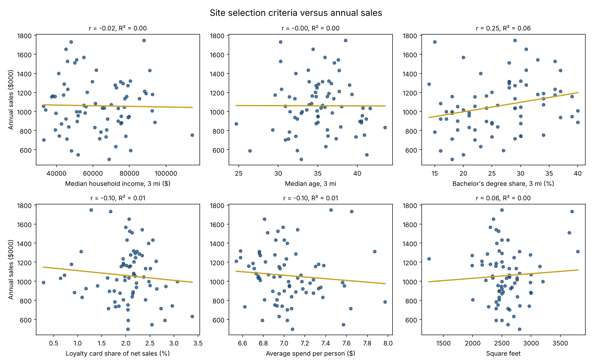

# Pastas R Us: Location Sales Analysis

Statistical analysis of 74 restaurant locations to find which site selection criteria predict annual sales and whether a loyalty card program earns its budget.


## The Business Problem

Pastas R Us, Inc. is choosing where to open its next locations and deciding whether to keep funding its loyalty card program. Leadership was picking sites on household income and square footage. The question was whether the data backs that up.

## Data

`data/pastas_r_us_locations.csv` holds one row per location (74 rows). See [data/data_dictionary.md](data/data_dictionary.md) for every field. Source: Pastas R Us, Inc.

## Approach

1. Descriptive statistics and IQR outlier screening for every field
2. Histogram and boxplot of annual sales, built from the raw rows
3. Simple linear regression of annual sales on each of six site criteria
4. Multiple regression with all six criteria entered together
5. Welch t test comparing high and low loyalty card locations

## Results

**One predictor at a time**

| Predictor | r | R² | p value | Significant |
|---|---|---|---|---|
| Bachelor's degree share (3 mi) | 0.25 | 0.062 | 0.032 | Yes |
| Loyalty card share of sales | -0.10 | 0.010 | 0.393 | No |
| Average spend per person | -0.10 | 0.009 | 0.414 | No |
| Square feet | 0.06 | 0.004 | 0.585 | No |
| Median household income (3 mi) | -0.02 | 0.001 | 0.855 | No |
| Median age (3 mi) | 0.00 | 0.000 | 0.979 | No |

**All predictors together:** R² = 0.143, adjusted R² = 0.066, overall p = 0.10. Education share stays significant (p = 0.007).

**Loyalty program:** high loyalty share locations average $1,078K in sales against $1,041K for low share locations. The gap is not significant (p = 0.57).



## Findings

1. Education share is the only criterion that predicts sales. Income, age, and square footage do not.
2. The six criteria together explain only 14 percent of the variation in sales. Most of what separates a strong location from a weak one is missing from this data.
3. The loyalty card program shows no measurable sales lift.

## Recommendations

1. Weight education share in site scoring and stop leaning on income alone.
2. Test a loyalty budget cut in a pilot group before cutting chain wide, and track visit frequency alongside sales.
3. Add foot traffic, competitor density, parking, and visibility to the site data.

## Project Structure

```
pastas-r-us-analysis/
├── data/                 raw data and data dictionary
├── notebooks/            full walkthrough with outputs
├── reports/              generated tables and figures
├── src/analysis.py       reusable analysis pipeline
├── tests/                pytest suite
└── .github/workflows/    CI runs tests and the pipeline on every push
```

## How to Run

```bash
pip install -r requirements.txt
python src/analysis.py --data data/pastas_r_us_locations.csv --out reports
pytest -q
```

Or open `notebooks/pastas_r_us_analysis.ipynb` for the narrated version.

## Tech Stack

Python, pandas, SciPy, statsmodels, Matplotlib, Jupyter, pytest, GitHub Actions

## Author

Randy O. Powell | [GitHub](https://github.com/TheSavage007) | [LinkedIn](https://www.linkedin.com/in/randy-powell-224a92bb)
